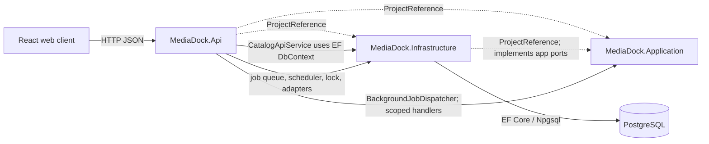
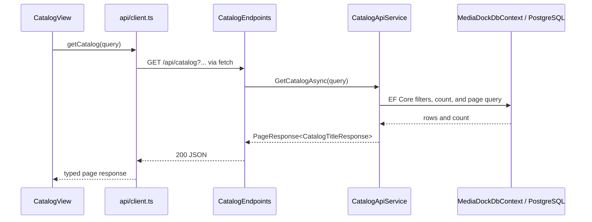
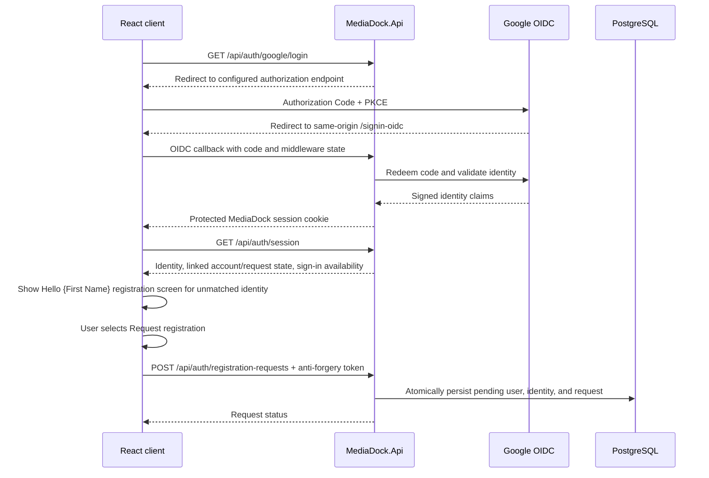
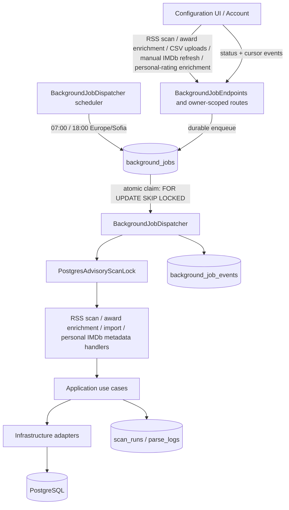
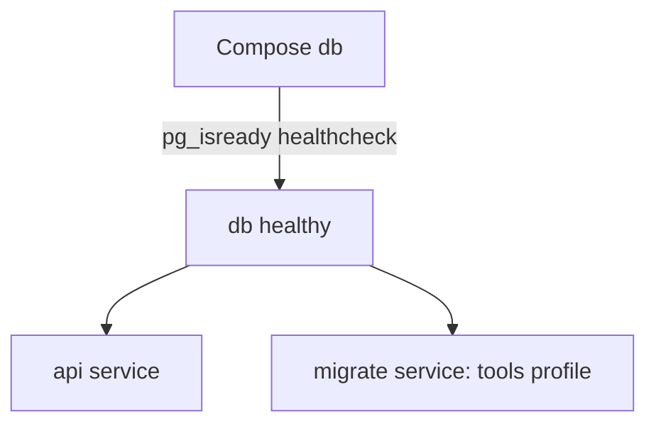

# Architecture and Runtime Flows

This guide covers the standalone React client, API-hosted background jobs, and PostgreSQL database. See [project context](PROJECT_CONTEXT.md) for the main directories and [local runbook](../../README.md) for operational commands.

## Responsibilities and Dependencies

Solid arrows show runtime traffic or calls; dashed arrows show .NET project references.

- [Application](../../server/src/MediaDock.Application/MediaDock.Application.csproj) has no project references. It contains ingestion use cases and contracts, parsing, matching, and metadata-resolution logic.
- [Infrastructure](../../server/src/MediaDock.Infrastructure/MediaDock.Infrastructure.csproj) references Application. It supplies PostgreSQL/EF Core persistence and adapters implementing application contracts, including the [PostgreSQL ingestion repository](../../server/src/MediaDock.Infrastructure/Ingestion/PostgresRssIngestionRepository.cs).
- [API](../../server/src/MediaDock.Api/MediaDock.Api.csproj) references Application and Infrastructure and is the only ingestion runtime/composition root. Its HTTP endpoints enqueue requests; one hosted dispatcher claims and executes them.
- The [web client](../../web/src/api/client.ts) is a separate React/TypeScript project that talks to the API over HTTP; it does not reference .NET projects. The [server Dockerfile](../../server/Dockerfile) builds the web app and copies its static output into the API image. In production the API serves those files, so Compose has no separate web service.

The project references describe what each project can reference, not the path every request takes. In particular, the current catalog read path is implemented in the API and directly uses Infrastructure's `MediaDockDbContext`; it does not pass through an Application catalog use case.

## Catalog HTTP Flow

 The [catalog view](../../web/src/features/catalog/CatalogView.tsx) builds the query and calls `getCatalog`; the [API client](../../web/src/api/client.ts) sends it to the API. The endpoint delegates to [CatalogApiService](../../server/src/MediaDock.Api/Catalog/CatalogApiService.cs), which queries Infrastructure's [DbContext](../../server/src/MediaDock.Infrastructure/Persistence/MediaDockDbContext.cs) directly. HTTP contracts are documented in [catalogs and awards](API_CATALOGS_AND_AWARDS.md).

## Optional Google Identity Flow

Optional sign-in is an API/browser/Google flow, not an authorization boundary. See [identity and personal data](API_IDENTITY_AND_PERSONAL_DATA.md) for its contracts and [security and operations](SECURITY_AND_OPERATIONS.md) for access and deployment requirements.

Catalog query behavior belongs in the API endpoint, contract, or service; do not add an Application abstraction unless a real shared use case emerges.

## API-Hosted Ingestion Flow

HTTP producers durably enqueue work; the API-hosted [dispatcher](../../server/src/MediaDock.Api/BackgroundJobs/BackgroundJobDispatcher.cs) claims and executes one job. Routes and lifecycle contracts are in [operations and jobs](API_OPERATIONS_AND_JOBS.md); scheduling, persistence, and coordination behavior are in [data behavior](DATA_BEHAVIOR.md).

## Startup and Health

Compose defines PostgreSQL, the API, and a one-shot migration service; the database healthcheck gates both application services. Normal API startup does not apply migrations, so use the [local runbook](../../README.md) for rollout order. The API serves the bundled React client in Production; build details are in the [server Dockerfile](../../server/Dockerfile). Health-route contracts and network policy are documented in [operations and jobs](API_OPERATIONS_AND_JOBS.md) and [security and operations](SECURITY_AND_OPERATIONS.md).

## Where to Change Things

| Change | Start here |
| --- | --- |
| HTTP route, validation, response contract, or catalog query | [CatalogEndpoints](../../server/src/MediaDock.Api/Catalog/CatalogEndpoints.cs), [CatalogContracts](../../server/src/MediaDock.Api/Catalog/CatalogContracts.cs), [CatalogApiService](../../server/src/MediaDock.Api/Catalog/CatalogApiService.cs), and [API Program](../../server/src/MediaDock.Api/Program.cs) |
| Golden Globes API catalog, import, or enrichment | [GoldenGlobeEndpoints](../../server/src/MediaDock.Api/GoldenGlobes/GoldenGlobeEndpoints.cs), [GoldenGlobeApiService](../../server/src/MediaDock.Api/GoldenGlobes/GoldenGlobeApiService.cs), [GoldenGlobeDatasetImporter](../../server/src/MediaDock.Infrastructure/GoldenGlobes/GoldenGlobeDatasetImporter.cs), and [GoldenGlobeEnrichmentService](../../server/src/MediaDock.Application/GoldenGlobes/GoldenGlobeEnrichmentService.cs) |
| Personal IMDb rating list, sort, or metadata enrichment | [PersonalRatingsEndpoints](../../server/src/MediaDock.Api/PersonalRatings/PersonalRatingsEndpoints.cs), [PersonalRatingsApiService](../../server/src/MediaDock.Api/PersonalRatings/PersonalRatingsApiService.cs), [ImdbTitleEnrichmentService](../../server/src/MediaDock.Application/PersonalRatings/ImdbTitleEnrichmentService.cs), and [PersonalRatingsView](../../web/src/features/sources/ConfigurationSettingsViews.tsx) |
| React screen, HTTP serialization, or browser types | [CatalogView](../../web/src/features/catalog/CatalogView.tsx), [API client](../../web/src/api/client.ts), and [api/types.ts](../../web/src/api/types.ts) |
| Feed parsing, ingestion sequencing, matching, or metadata-resolution behavior | [RssIngestionService](../../server/src/MediaDock.Application/Ingestion/RssIngestionService.cs), [ingestion contracts](../../server/src/MediaDock.Application/Ingestion/RssIngestionContracts.cs), [RutrackerTitleParser](../../server/src/MediaDock.Application/Parsing/RutrackerTitleParser.cs), [MatchPolicy](../../server/src/MediaDock.Application/Matching/MatchPolicy.cs), and [MetadataResolver](../../server/src/MediaDock.Application/Metadata/MetadataResolver.cs) |
| Oscar CSV import, nominated-film persistence, or category filtering | [BackgroundJobApiService](../../server/src/MediaDock.Api/BackgroundJobs/BackgroundJobApiService.cs), [OscarDatasetImporter](../../server/src/MediaDock.Infrastructure/OscarAwards/OscarDatasetImporter.cs), [OscarCsvDatasetReader](../../server/src/MediaDock.Infrastructure/OscarAwards/OscarCsvDatasetReader.cs), and Oscar persistence entities/configurations |
| PostgreSQL schema, EF mapping, ingestion persistence, or provider adapters | Infrastructure persistence beginning at [MediaDockDbContext](../../server/src/MediaDock.Infrastructure/Persistence/MediaDockDbContext.cs), [PostgresRssIngestionRepository](../../server/src/MediaDock.Infrastructure/Ingestion/PostgresRssIngestionRepository.cs), [PostgresMetadataCacheStore](../../server/src/MediaDock.Infrastructure/Metadata/PostgresMetadataCacheStore.cs), [OmdbClient](../../server/src/MediaDock.Infrastructure/Metadata/OmdbClient.cs), and [RssFeedTransportAdapter](../../server/src/MediaDock.Infrastructure/Ingestion/RssFeedTransportAdapter.cs); use the [local runbook](../../README.md) for migration order |
| Job persistence, atomic claim, schedule, progress, or recovery | [BackgroundJobDispatcher](../../server/src/MediaDock.Api/BackgroundJobs/BackgroundJobDispatcher.cs), [BackgroundJobScheduler](../../server/src/MediaDock.Api/BackgroundJobs/BackgroundJobScheduler.cs), and [BackgroundJobConfigurations](../../server/src/MediaDock.Infrastructure/Persistence/Configurations/BackgroundJobConfigurations.cs) |
| Image targets, service startup, or local operational procedure | [server Dockerfile](../../server/Dockerfile), [Compose](../../compose.yaml), and the [local runbook](../../README.md) |