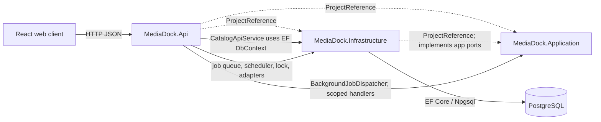
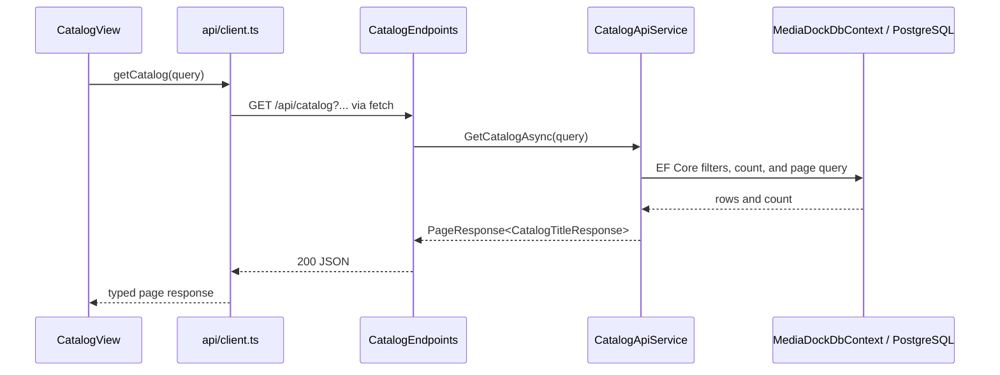
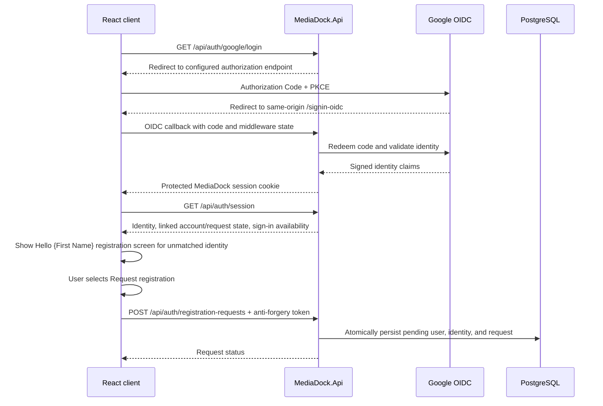
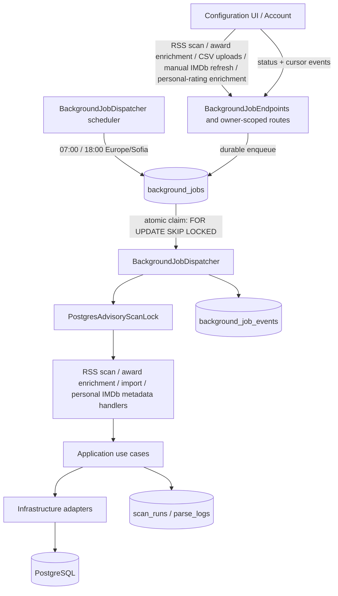
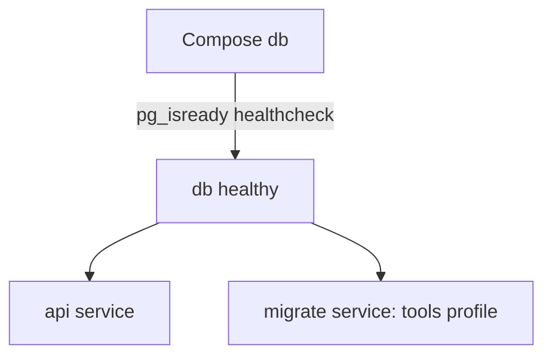

# Architecture and Runtime Flows

This guide focuses on runtime boundaries and cross-layer flows that are easy to miss from a single source file. See the [local runbook](../../README.md) for setup and operational commands.

## Responsibilities and Dependencies

Solid arrows show runtime traffic or calls; dashed arrows show .NET project references.

- [Application](../../server/src/MediaDock.Application/MediaDock.Application.csproj) has no project references. It contains ingestion use cases and contracts, parsing, matching, and metadata-resolution logic.
- [Infrastructure](../../server/src/MediaDock.Infrastructure/MediaDock.Infrastructure.csproj) references Application. It supplies PostgreSQL/EF Core persistence and adapters implementing application contracts, including the [PostgreSQL ingestion repository](../../server/src/MediaDock.Infrastructure/Ingestion/PostgresRssIngestionRepository.cs).
- [API](../../server/src/MediaDock.Api/MediaDock.Api.csproj) references Application and Infrastructure and is the only ingestion runtime/composition root. Its HTTP endpoints enqueue requests; one hosted dispatcher claims and executes them.
- The [web client](../../web/src/api/client.ts) is a separate React/TypeScript project that talks to the API over HTTP; it does not reference .NET projects. The [server Dockerfile](../../server/Dockerfile) builds the web app and copies its static output into the API image. In production the API serves those files, so Compose has no separate web service.

The project references describe what each project can reference, not the path every request takes. In particular, the current catalog read path is implemented in the API and directly uses Infrastructure's `MediaDockDbContext`; it does not pass through an Application catalog use case.

## Catalog HTTP Flow

The [catalog view](../../web/src/features/catalog/CatalogView.tsx) builds the query and calls `getCatalog`; the [API client](../../web/src/api/client.ts) sends it to the API. The endpoint delegates to [CatalogApiService](../../server/src/MediaDock.Api/Catalog/CatalogApiService.cs), which queries Infrastructure's [DbContext](../../server/src/MediaDock.Infrastructure/Persistence/MediaDockDbContext.cs) directly. Keep this read path API-owned unless a shared Application use case emerges. HTTP contracts are documented in [catalogs and awards](API_CATALOGS_AND_AWARDS.md).

RSS preview reads follow a separate cache path: `GET /api/catalog/rss/{profileId}` reads the latest persisted snapshot, while `POST /api/catalog/rss/{profileId}/refresh` fetches enabled source URLs and stores a new snapshot. Refresh retains five snapshots per profile; opening the preview does not contact RSS sources.

## Optional Google Identity Flow

Optional sign-in is an API/browser/Google flow, not an authorization boundary. See [identity and personal data](API_IDENTITY_AND_PERSONAL_DATA.md) for its contracts and [security](SECURITY.md) for access and deployment requirements.

## API-Hosted Ingestion Flow

HTTP producers durably enqueue work; the API-hosted [dispatcher](../../server/src/MediaDock.Api/BackgroundJobs/BackgroundJobDispatcher.cs) claims and executes one job. Routes and lifecycle contracts are in [operations and jobs](API_OPERATIONS_AND_JOBS.md); scheduling, persistence, and coordination behavior are in [data behavior](DATA_BEHAVIOR.md).

## Startup and Health

Compose defines PostgreSQL, the API, and a one-shot migration service; the database healthcheck gates both application services. Normal API startup does not apply migrations, so use the [local runbook](../../README.md) for rollout order. The API serves the bundled React client in Production; build details are in the [server Dockerfile](../../server/Dockerfile). Health-route contracts and network policy are documented in [operations and jobs](API_OPERATIONS_AND_JOBS.md) and [security](SECURITY.md).

